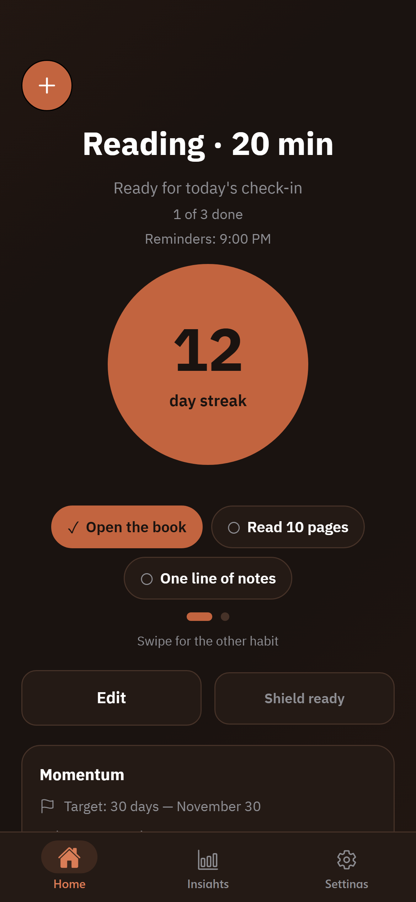
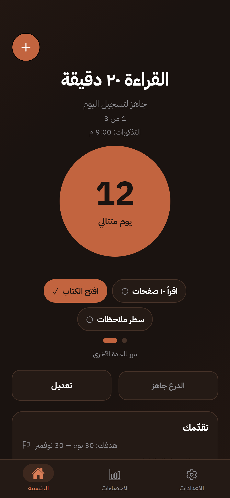
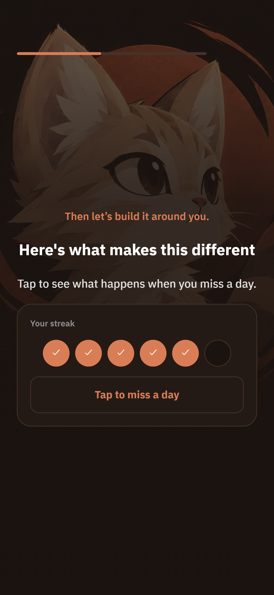
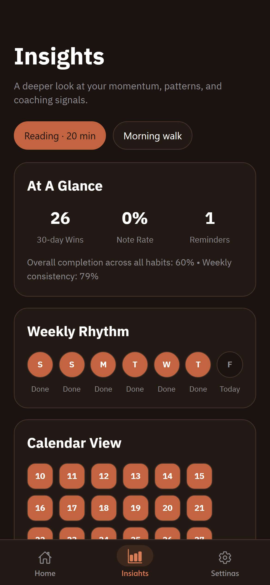
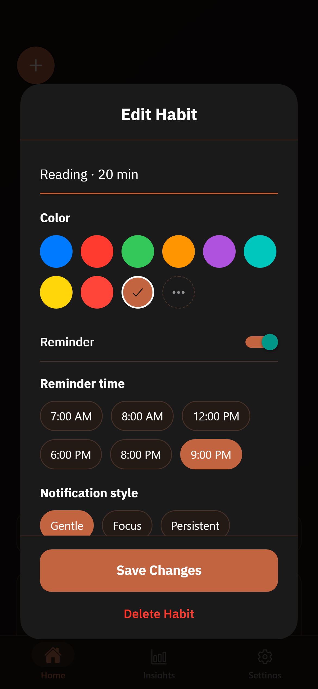
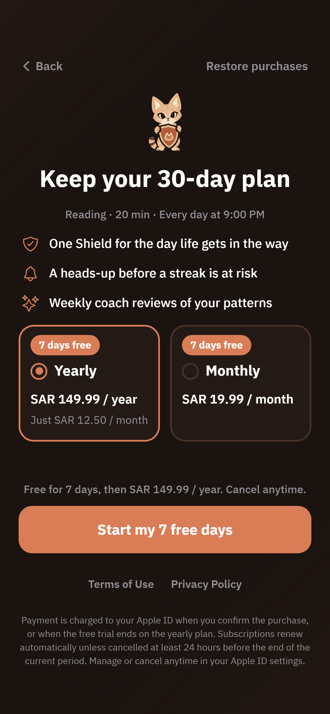
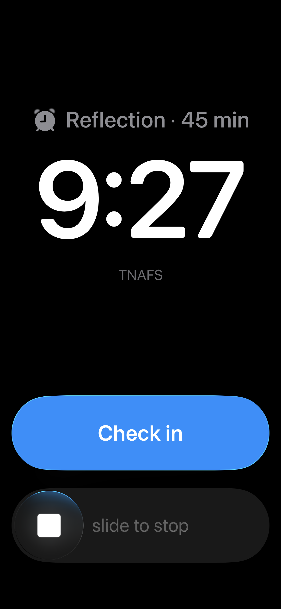

  

<h1 align="center">TNAFS · تنافس</h1>

  An Arabic-first habit app for iPhone that helps people stay consistent and recover fast when they slip. 
  <b>Formerly HabitStreak.</b> Live on the App Store since October 2026, with about 6,000 downloads.

  <a href="https://apps.apple.com/app/id6819559733">Download on the App Store</a> · <a href="https://tnafs.netlify.app">Website</a>

> This is a public showcase. The app's source code lives in a private repository.
> I'm happy to walk through it. Contact: hmdalharby7@gmail.com

---

## Screenshots

| Home | Home (Arabic, RTL) | Shield demo in onboarding |
| :---: | :---: | :---: |
|  |  |  |

| Insights | Edit habit and reminders | Paywall |
| :---: | :---: | :---: |
|  |  |  |

   
  On a real iPhone: a TNAFS reminder ringing as a system alarm through iOS 26 AlarmKit (version 1.1.1).

Screenshots are from version 1.1.1, captured November 2026.

## The idea

Most habit apps punish one missed day by wiping the streak, and that is usually when people quit.
TNAFS keeps the pressure of a streak but makes a single slip survivable:

- **One Shield per habit.** It covers exactly one missed day. Once used, it comes back only after
  7 check-ins in a row. Shields never stack and can't be bought, so the streak still means something.
- **Strict mode** for people who want no safety net at all.
- **Goals that keep going.** Reaching a goal opens a celebration and asks for the next one;
  the streak keeps counting instead of resetting.
- **A sand cat mascot** that reacts to what just happened: waving, guarding, proud, or comforting.

## What I built

- **Onboarding where every question configures something real.** Goal, obstacle, daily time and
  commitment length become the starter habit, its reminder style, its name and the target on Home.
  It's tap-only, with no typing, and includes a hands-on demo of how the Shield saves a streak.
- **Streak engine** written as pure functions over `YYYY-MM-DD` date keys instead of `Date` objects,
  so decay, Shield use and refills are testable without timezone bugs. Every saved record passes
  through a normalizer, so older installs upgrade safely.
- **Subscriptions with RevenueCat.** A hard paywall with a 7-day free trial, prices loaded from the store,
  trial-eligibility checks, restore purchases, and App Store guideline 3.1.2 requirements built in.
- **Reminders that are hard to miss.** Local notifications with Gentle, Focus and Persistent styles.
  Version 1.1.1 adds reminders that ring as real system alarms on iOS 26 through AlarmKit.
- **Shipping and fixing in production.** EAS builds, TestFlight and over-the-air updates. I used
  PostHog and RevenueCat funnels to find where people drop off, and diagnosed and fixed a bug that
  broke the paywall for returning users, shipped as an over-the-air update.
- **Arabic-first localization.** Full RTL layout, all six Arabic plural forms, Gulf-dialect copy,
  and an English version.
- **Brand and accessibility.** A sand-cat mascot in five poses. Animations are disabled when
  Reduce Motion is on, and decorative art is hidden from screen readers.
- **Privacy by design.** No account is needed, and habit data stays on the phone.
  Subscription status goes to RevenueCat, and app usage analytics go to PostHog.

## Tech stack

- **Framework:** Expo SDK 57 · React Native 0.86 · React 19 · TypeScript · Expo Router (typed routes)
- **Shipping:** EAS Build, TestFlight and over-the-air updates
- **Analytics:** PostHog (funnels and feature flags) and RevenueCat
- **Libraries:**
  - react-native-purchases (RevenueCat)
  - expo-notifications
  - expo-store-review
  - react-native-svg
  - react-native-view-shot + expo-sharing
- **Localization:** i18next
- **Storage:** AsyncStorage (local-first)
- **Website:** static HTML on Netlify, with the waitlist stored in Supabase

## Status

- **Live on the App Store** since 14 October 2026 (iPhone), about 6,000 downloads.
- **Version 1.1.1 submitted to Apple on 12 November 2026**, in review. It adds reminders that ring as
  real system alarms on iOS 26 (AlarmKit), Loud reminders by default, a redesigned Day 0 to Day 2
  first-run experience, and a 7-day free trial on both plans.
- **Planned for later:** backup and sync with Supabase accounts, then opt-in leagues with friends.

---

Built by <a href="https://github.com/Ha1mad">@Ha1mad</a>

