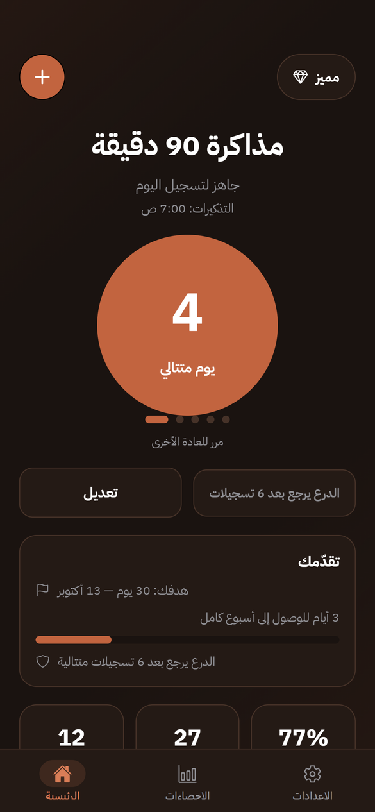
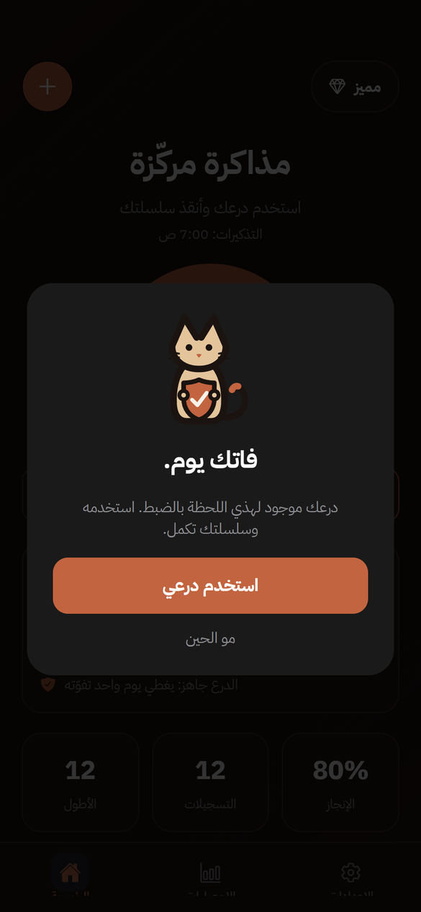
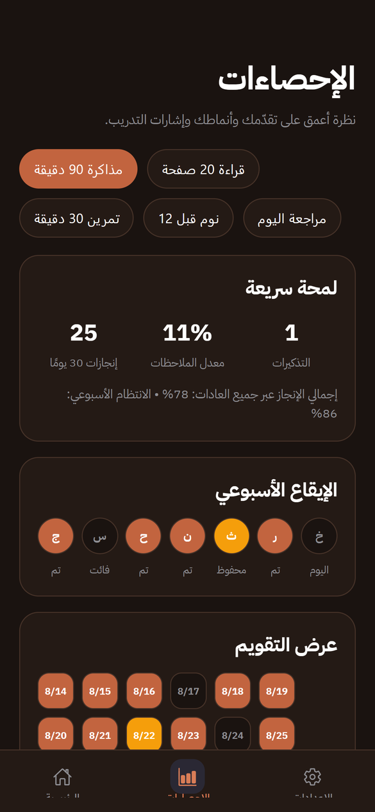
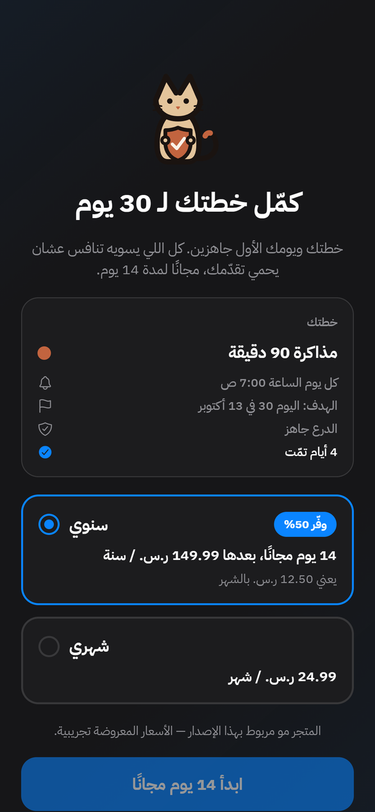

  

<h1 align="center">TNAFS · تنافس</h1>

  An Arabic-first habit app for iPhone that helps people stay consistent and recover fast when they slip. 
  <b>Formerly HabitStreak.</b> Live on the App Store since October 2026, with about 6,000 downloads.

  <a href="https://apps.apple.com/app/id6819559733">Download on the App Store</a> · <a href="https://tnafs.netlify.app">Website</a>

> This is a public showcase. The app's source code lives in a private repository.
> I'm happy to walk through it. Contact: hmdalharby7@gmail.com

---

## Screenshots

| Onboarding | Home | Shield |
| :---: | :---: | :---: |
|  |  |  |

| Goal reached | Insights | Paywall |
| :---: | :---: | :---: |
|  |  |  |

## The idea

Most habit apps punish one missed day by wiping the streak, and that is usually when people quit.
TNAFS keeps the pressure of a streak but makes a single slip survivable:

- **One Shield per habit.** It covers exactly one missed day. Once used, it comes back only after
  7 check-ins in a row. Shields never stack and can't be bought, so the streak still means something.
- **Strict mode** for people who want no safety net at all.
- **Goals that keep going.** Reaching a goal opens a celebration and asks for the next one;
  the streak keeps counting instead of resetting.
- **A sand cat mascot** that reacts to what just happened: waving, guarding, proud, or comforting.

## What I built

- **Onboarding where every question configures something real.** Goal, obstacle, daily time and
  commitment length become the starter habit, its reminder style, its name and the target on Home.
  It's tap-only, with no typing, and ends with a real first check-in before the paywall.
- **Streak engine** written as pure functions over `YYYY-MM-DD` date keys instead of `Date` objects,
  so decay, Shield use and refills are testable without timezone bugs. Every saved record passes
  through a normalizer, so older installs upgrade safely.
- **Subscriptions with RevenueCat.** A hard paywall with a 7-day free trial on the yearly plan, prices loaded from the store,
  trial-eligibility checks, restore purchases, and App Store guideline 3.1.2 requirements built in.
- **Prompts timed so they don't feel pushy.** The notification permission is asked on day 2 through
  a one-button primer, and people who declined get a gentle follow-up. The review prompt appears only
  after a milestone, using Apple's own sheet. Shareable streak cards appear from day 7.
  There's at most one interruption per launch.
- **Arabic-first localization.** Full RTL layout, all six Arabic plural forms, Gulf-dialect copy,
  and an English version.
- **Brand and accessibility.** The mascot and icon are drawn in code as SVG. Animations are
  disabled when Reduce Motion is on, and decorative art is hidden from screen readers.
- **Privacy by design.** No account is needed, and habit data stays on the phone.
  Subscription status goes to RevenueCat, and app usage analytics go to PostHog.

## Tech stack

- **Framework:** Expo SDK 57 · React Native 0.86 · React 19 · TypeScript · Expo Router (typed routes)
- **Shipping:** EAS Build, TestFlight and over-the-air updates
- **Analytics:** PostHog (funnels and feature flags) and RevenueCat
- **Libraries:**
  - react-native-purchases (RevenueCat)
  - expo-notifications
  - expo-store-review
  - react-native-svg
  - react-native-view-shot + expo-sharing
- **Localization:** i18next
- **Storage:** AsyncStorage (local-first)
- **Website:** static HTML on Netlify, with the waitlist stored in Supabase

## Status

- **Live on the App Store** since 14 October 2026 (iPhone), about 6,000 downloads.
- Shipped updates through v1.1.0; v1.1.1 is in development.
- **Planned for later:** backup and sync with Supabase accounts, then opt-in leagues with friends.

---

Built by <a href="https://github.com/Ha1mad">@Ha1mad</a>

